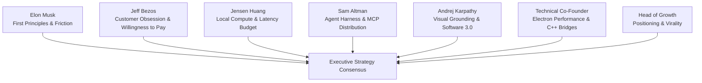
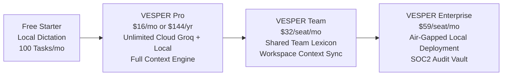
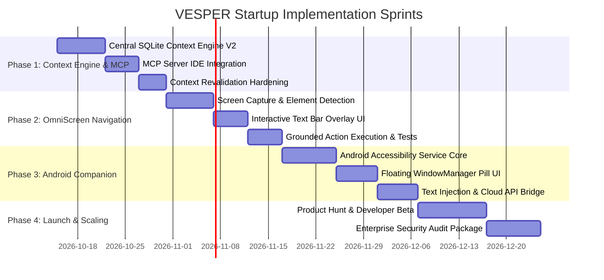

# VESPER Startup Master Plan: Autonomous Agentic Context, Dictation & Desktop Action System

---

## Executive Summary & Vision

**VESPER** is an **ambient, context-aware intelligence layer** for modern knowledge workers, engineers, and creators. It sits unobtrusively on the user's desktop (and mobile device), continuously understanding the active workspace, listening to speech with sub-300ms latency, predicting user intent, and executing universal actions across operating system applications.

Unlike traditional speech dictation utilities that merely transcribe raw audio into dumb text boxes, VESPER is built around a **Central 24/7 Context Engine** that captures active application states, accessibility trees, and screen diffs, enabling **context-grounded dictation, prompt generation, and direct screen navigation**.

```
┌───────────────────────────────────────────────────────────────────────────────────┐
│                                 THE VESPER FLYWHEEL                                │
│                                                                                   │
│    [Continuous Desktop Context] ───► [Ultra-Low Latency Speech Input]             │
│            ▲                                     │                                │
│            │                                     ▼                                │
│    [MCP Server for IDEs/AI]     [Context-Ranked LLM Polisher & Router]           │
│            ▲                                     │                                │
│            │                                     ▼                                │
│    [OmniScreen Visual Navigator] ◄── [Native Keystroke & Universal Action System] │
└───────────────────────────────────────────────────────────────────────────────────┘
```

---

## 1. Employee Boardroom Alignment & Advisory Synthesis

Before drafting the engineering roadmap, the founding team simulated an executive boardroom session across VESPER's specialized advisory and executive personas (defined in `employees/`):



### Advisory Board Feedback Breakdown

*   **Elon Musk (First Principles & Friction Erasure):**
    > *"Every millisecond of latency is a friction tax on human thought. If a user presses a hotkey and has to wait 500ms before they can speak, the product is dead. The entire chain—audio ring buffer, transcription, context fusion, text injection—must run in under 300ms. Keep the UI ultra-minimal: zero redundant dialogs, zero clicks to confirm obvious edits. The best interface is no interface."*

*   **Jeff Bezos (Customer Obsession & Willingness to Pay):**
    > *"Start with the customer and work backwards. Why will an engineer or founder pay $20/month for VESPER? Not because it has AI, but because it saves them 45 minutes of typing and context-switching every single day. If VESPER remembers what they were coding in VS Code 2 hours ago and formats a Slack update without them copying and pasting, that is immediate ROI."*

*   **Jensen Huang (Compute Architecture & Local Execution):**
    > *"Cloud latency is governed by the speed of light and network jitter. Local NPU and GPU acceleration is governed by hardware bandwidth. By running speech detection (Whisper/Moonshine ONNX) and embedding generation locally on-device, you eliminate inference bills and provide an ironclad privacy guarantee. The enterprise wedge is 100% on-device data sovereignty."*

*   **Sam Altman (Agent Harness & Ecosystem Distribution):**
    > *"Autonomous agents without an environment harness are just text generators. VESPER should not try to be a closed silo. By implementing an official Model Context Protocol (MCP) server, VESPER instantly becomes the sensory organ (eyes and memory) for Cursor, Claude Desktop, Windsurf, and custom agentic frameworks."*

*   **Andrej Karpathy (Visual Grounding & Screen Navigation):**
    > *"Traditional accessibility APIs break on non-standard UIs (Electron apps, games, custom canvases). Implementing a vision-grounded screen navigator (inspired by OmniParser/UI-TARS) where the system parses interactive bounding boxes and displays a discreet text bar indicating what to click turns VESPER from a voice tool into a full computer-use copilot."*

*   **Technical Co-Founder & Software Engineer (Electron Pragmatism):**
    > *"While Rust offers lower baseline RAM, Electron provides rapid developer velocity, instant cross-platform UI iteration, and an expansive Node.js ecosystem. We will optimize Electron by offloading heavy work to C++ native binaries (`send-input.exe`, `detect-window.exe`, `WinKeyServer.exe`), running ONNX models in Web Workers, and utilizing SQLite WASM/C++ for zero main-thread blocking."*

---

## 2. Market Research & Competitive Strategy

### 2.1 Market Opportunity & TAM
*   **Total Addressable Market (TAM):** $28B (Global Speech-to-Text, Ambient AI, and Robotic Desktop Automation market by 2028).
*   **Serviceable Addressable Market (SAM):** $6.2B (Knowledge workers, software developers, technical founders, and product managers).
*   **Serviceable Obtainable Market (SOM):** $180M (Proactive Windows & Android power users who spend 4+ hours daily in IDEs, Slack, and document editors).

### 2.2 Competitive Differentiation Matrix

| Capability | VESPER | Cloud Dictation Tools | Legacy macOS Tools | Native OS Copilots |
| :--- | :---: | :---: | :---: | :---: |
| **Windows First-Class Tier** | **Yes (Full Win32)** | Poor / Web Only | No (macOS Only) | Basic / Inconsistent |
| **Android Floating Overlay** | **Yes (Accessibility)** | No | No | No |
| **24/7 Local Context Engine** | **Yes (SQLite Local)** | No (Cloud Upload) | No (Dictation Only) | Cloud / Monolithic |
| **Model Context Protocol (MCP)** | **Native Server Built-in** | No | No | Closed API |
| **Visual Screen Navigation** | **Yes (OmniParser text bar)**| No | No | Basic browser only |
| **Latency Budget** | **<300ms End-to-End** | 800ms - 2000ms | 400ms - 800ms | 1000ms+ |
| **Data Privacy** | **100% Local Capable** | Third-party cloud | Mixed | Cloud Telemetry |

### 2.3 Willingness to Pay & User Personas
1.  **Software Engineers & Technical Leads ($20/mo):** Dictating code comments, architecture RFCs, GitHub PR descriptions, and Slack updates with accurate casing (`camelCase`, `PascalCase`, markdown code fences).
2.  **Founders & Product Managers ($20/mo):** Rapid ideation, writing PRDs, drafting emails, and having past meeting context automatically retrieved.
3.  **Enterprise Security Teams ($45/user/mo):** Demanding zero audio or screen data leave employee laptops (ITAR, HIPAA, SOC 2 compliance).

---

## 3. Business & Monetization Architecture



### Pricing Tiers
*   **Community / Free:**
    *   100% local on-device Whisper transcription (unlimited).
    *   Basic deterministic text polishing.
    *   Standard push-to-talk pill.
*   **VESPER Pro ($16/month billed annually or $20/month billed monthly):**
    *   Ultra-fast Groq Llama 3.3 70B cloud post-processing (sub-120ms).
    *   24/7 Local Context Engine with 30-day temporal search.
    *   Model Context Protocol (MCP) server integration for Cursor & VS Code.
    *   Android companion app with floating input overlay.
    *   OmniScreen visual navigation assistant.
*   **VESPER Enterprise ($59/seat/month):**
    *   Air-gapped deployment with zero external network calls.
    *   Custom organizational lexicon & vocabulary sync.
    *   Dedicated compliance audit log vault.

### Unit Economics (COGS)
*   **On-Device Processing:** $0.00 marginal cost per dictation.
*   **Groq Cloud Processing:**
    *   Whisper Large v3 audio transcription: ~$0.0001 per 10-second dictation.
    *   Llama 3.3 70B post-processing: ~$0.00015 per completion.
    *   Total cloud cost per heavy power user (50 dictations/day): **~$0.37/month**.
    *   **Gross Margin:** **> 97%** on Pro tier subscriptions.

---

## 4. Full Technical Architecture (Electron + Native C++ + Local Models)

As decided with the team, VESPER leverages **Electron** for developer velocity, wrapped with high-performance native modules to eliminate all latency bottlenecks.

```mermaid
flowchart TB
    subgraph UI ["Electron Renderer (React 19 + TypeScript)"]
        HUD[Floating Capsule Pill]
        Dash[VesperDashboard Mission Control]
        ScreenBar[Screen Navigation Text Bar]
        AudioVis[20-Band Audio Visualizer]
    end

    subgraph NativeBridge ["Native Windows Subsystem (C++ / Win32)"]
        SendInput[send-input.exe / Win32 Unicode Injector]
        DetectWindow[detect-window.exe / Active HWND Hook]
        KeyServer[WinKeyServer.exe / Low-Level PTT Hook]
        UIA[UIAutomation / Accessibility Tree]
    end

    subgraph CoreEngine ["Electron Main Process Engine"]
        ContextStore[ContextStore (SQLite In-Process)]
        ContextCollector[ContextCollector & Revalidator]
        ActionExecutor[Universal Action Executor]
        MCPServer[VESPER MCP Server (Stdio/SSE)]
    end

    subgraph AIInference ["Dual Inference Engine"]
        LocalONNX[Local Whisper & Embedding ONNX]
        CloudGroq[Groq Llama 3.3 70B & Whisper API]
    end

    subgraph AndroidApp ["Android Companion Ecosystem"]
        AccessibilitySvc[AccessibilityService]
        FloatingView[WindowManager Overlay Pill]
        LocalSpeech[Android Speech / Whisper TFLite]
    end

    UI <==> |IPC (ContextBridge)| CoreEngine
    CoreEngine <==> NativeBridge
    CoreEngine <==> AIInference
    CoreEngine <==> |Local WebSocket / Tailscale| AndroidApp
    MCPServer <==> |JSON-RPC (MCP)| IDEs[Cursor / VS Code / Claude]
```

---

## 5. Central 24/7 Context Engine Specification

### 5.1 What Gets Ingested
The Central Context System captures four distinct signals without burdening CPU:
1.  **Window Focus Events:** Monitored via Win32 `SetWinEventHook` (`EVENT_SYSTEM_FOREGROUND`). Captures active process name, executable path, and window title.
2.  **UIAutomation Tree Snapshots:** Reads focused control type (edit box, document, button) and caret coordinates without triggering intrusive clipboard operations.
3.  **Active Workspace Scans:** When focused on developer tools (VS Code, Cursor, Terminal), reads current repository directory, open filename, active git branch, and language syntax.
4.  **Temporal Event Journal:** All events are written into `vesper-context.sqlite` with indexed timestamps.

### 5.2 Context Ranking & Query Synthesis
When speech is triggered, the **Context Ranker** synthesizes a compact prompt token packet (<200 tokens):
```json
{
  "activeApp": "Cursor",
  "windowTitle": "groq-service.ts - VESPER",
  "activeFile": "src/renderer/src/core/groq-service.ts",
  "projectWorkspace": "VESPER",
  "recentClipboard": "export async function polishWithGroqLlama(...)",
  "activeLanguage": "typescript",
  "domain": "coding"
}
```

---

## 6. Model Context Protocol (MCP) Server for IDEs & AI Agents

VESPER runs an embedded MCP server (`src/main/mcp-server.ts`) over standard stdio or local SSE. This allows any external agent (Cursor Agent, Windsurf, Claude Desktop, Antigravity) to query real-time desktop context.

### 6.1 Exposed MCP Tools
1.  `vesper_get_current_context`: Returns current active application, active file path, window title, and active text selection.
2.  `vesper_search_desktop_history`: Performs semantic vector + keyword search over past dictations, code snippets, and window events.
3.  `vesper_inject_text`: Allows an external AI agent to inject polished text directly into the user's active cursor position.
4.  `vesper_execute_action`: Triggers safe universal desktop actions (file creation, app launch, clipboard copy) gated by VESPER's security rules.

### 6.2 Configuration Snippet for `cursor/mcp.json` / Claude Desktop
```json
{
  "mcpServers": {
    "vesper": {
      "command": "node",
      "args": ["C:/Users/gowri/Videos/___WS_VESPER_PATH___/out/main/mcp-runner.js"]
    }
  }
}
```

---

## 7. OmniScreen Visual Navigation & Text Bar Assistant

### 7.1 Concept & User Interaction
When the user gives an imperative navigation prompt (e.g. *"Click on the pull requests tab in GitHub"*, *"Open the settings in VS Code"*):
1.  **Screen Capture:** A high-resolution screen buffer is captured via Electron `desktopCapturer`.
2.  **Interactable Region Tokenization:** Elements are parsed into bounding boxes using lightweight local edge/OCR detection or fast vision inference.
3.  **Discreet Text Bar Overlay:** A floating navigation bar displays at the bottom/top of the screen:
    ```
    ┌────────────────────────────────────────────────────────┐
    │ 🎯 VESPER Nav: Clicking [Pull requests] at (842, 126)   │
    │ [Space] Confirm  •  [Esc] Cancel  •  [Tab] Next Match  │
    └────────────────────────────────────────────────────────┘
    ```
4.  **Target Highlight:** A glowing neon bounding box illuminates the target element.
5.  **Execution:** Upon confirmation (or auto-confirm if high confidence), native Win32 mouse/keyboard events click and focus the target.

---

## 8. Mobile Companion: Android Floating Overlay Architecture

### 8.1 Android Implementation Details
The mobile version operates identically to the desktop capsule:
*   **AccessibilityService (`VesperAccessibilityService`):**
    *   Monitors `AccessibilityEvent.TYPE_VIEW_FOCUSED`.
    *   Checks if `AccessibilityNodeInfo.isEditable() == true`.
*   **WindowManager Floating Capsule (`WindowManager.LayoutParams.TYPE_APPLICATION_OVERLAY`):**
    *   When an input field is focused, a compact, translucent floating microphone pill animates into view near the keyboard or thumb area.
    *   **Tap / Hold Interaction:**
        *   **Tap or Hold:** Starts audio recording via Android AudioRecord (16kHz mono PCM).
        *   **Release or Tap again:** Stops recording, passes audio through local Whisper TFLite/ONNX or Groq cloud API.
        *   **Injection:** Uses `AccessibilityNodeInfo.performAction(AccessibilityNodeInfo.ACTION_SET_TEXT, textArgs)` to instantly populate the text box without needing clipboard replacement.
*   **Cross-Device Sync:** Local WiFi/Bluetooth sync of custom vocabulary, snippets, and app profiles between the desktop app and mobile companion.

---

## 9. Comprehensive Execution Roadmap



---

## 10. Verification & Quality Assurance Strategy

1.  **Automated Unit & Integration Tests:**
    *   Run `npm run test` across all 32+ test suites verifying context ingestion, intent classification, tokenization, and revalidation.
2.  **Native Windows E2E Verification:**
    *   Verify `send-input.exe` and `detect-window.exe` under real multi-window conditions (VS Code, Cursor, Chrome, Slack, Windows Terminal).
3.  **Production Bundling:**
    *   Validate `npm run build` cleanly packages main, preload, and renderer with zero warnings.
4.  **Security & Privacy Audit:**
    *   Verify that in `strict_local` privacy mode, zero network sockets are opened during recording and post-processing.
